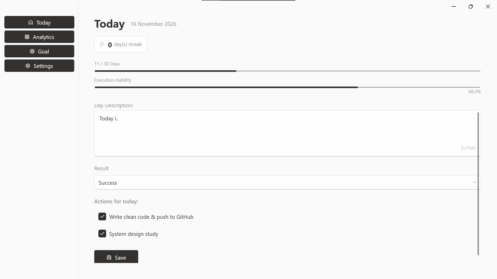
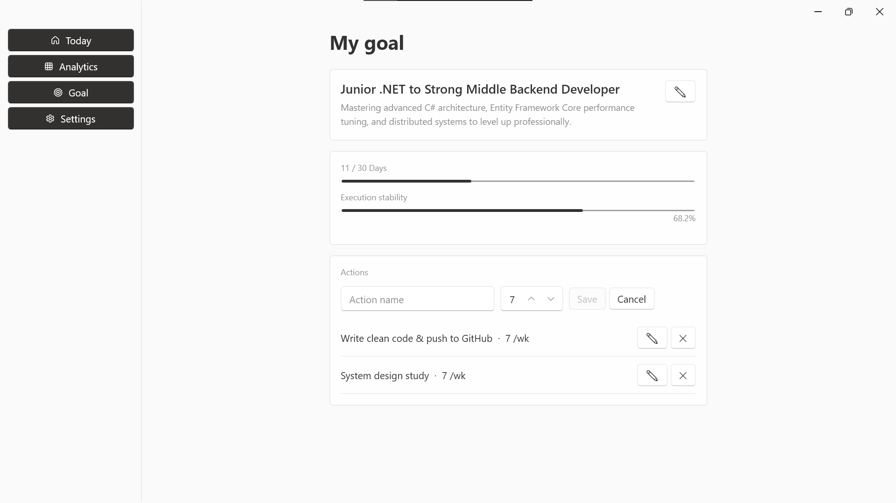
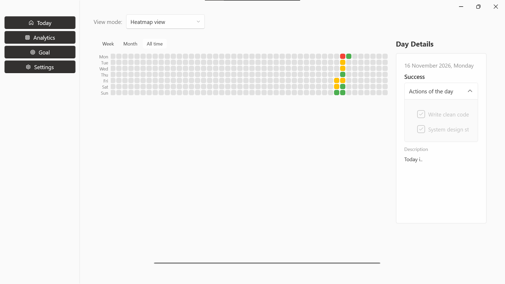
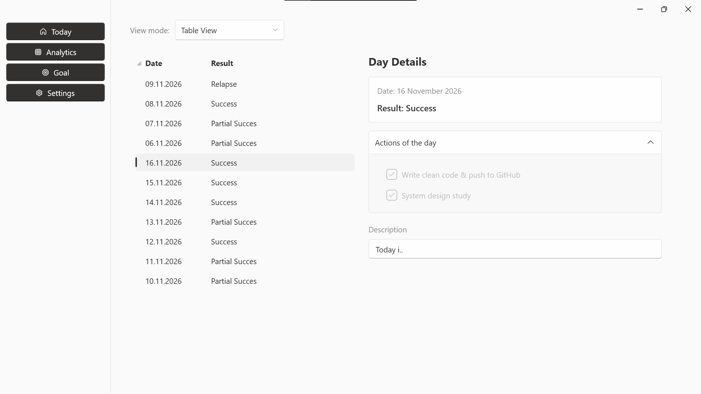

# ProgressApp

[](https://github.com/DiaToR777/ProgressApp/releases/latest)


🇬🇧 English · 🇺🇦 [Українська](#українською)

Local-first desktop app for tracking personal goals: set a goal, break it into a time-boxed milestone with daily or weekly actions, check in every day, and track your progress. All data stays on your machine in an encrypted SQLite database (SQLCipher).

| Today | Goal |
| :---: | :---: |
|  |  |

| Heatmap | History |
| :---: | :---: |
|  |  |

## Core Features

- **Goal → milestone → actions:** one active goal at a time, split into a time-boxed milestone with actions at 1–7× per week, editable at any time.
- **Two progress metrics:** days elapsed, and consistency. Daily actions count the same day. Weekly actions (1–6× per week) are tallied only at the end of their week — so a single checkmark doesn't raise the score right away, and rest days don't lower it.
- **Check-ins:** action checkboxes, a free-text note, a day rating. Saving updates the same day's entry, so you can add or remove checkmarks later in the day.
- **Milestone completion flow:** the app suggests an outcome (achieved at ≥70% consistency) and you decide — achieved / not achieved / extend by N days.
- **Heatmap & history:** week/month/year heatmap colored by how much of the day's plan was completed, plus a per-day history table.
- **Local & encrypted:** SQLCipher encryption; password login; you can change the password later; automatic `.bak` backup and schema migration when opening an old `v1.x` database.
- **UI & localization:** light/dark themes, English and Ukrainian.

## Architecture & Stack

Clean Architecture — dependencies point inward:

```
WpfUI --> Application --> Domain <-- Infrastructure
```

- **Domain:** entities (`Goal`, `Milestone`, `GoalAction`, `DailyCheckin`, `ActionLog`, `User`) and interfaces. No framework dependencies.
- **Application:** business rules — progress calculation, milestone completion, onboarding.
- **Infrastructure:** EF Core, repositories, migrations, database encryption and password handling.
- **WpfUI:** MVVM views and view models (CommunityToolkit.Mvvm), localization, theming.

A few decisions worth knowing: progress is **calculated from your check-ins every time it's shown**, not stored as a fixed number — so when you edit or delete an action, the numbers automatically stay correct and can't get out of sync. The daily score uses **what was logged that day**, not the milestone's current action list. Check-ins can exist **without a goal** (`MilestoneId` is nullable), and milestones are **history**, not a single field on the goal.

**Stack:** C# / .NET 8 · WPF + [WPF-UI](https://github.com/lepoco/wpfui) · EF Core + SQLite + SQLCipher · CommunityToolkit.Mvvm · Microsoft.Extensions.DependencyInjection · Serilog · MSTest + Moq + FluentAssertions.

## Known Limitations

- **Weekly actions and a missed Sunday.** Weekly actions are scored on the last day of their week. If you don't open the app that day, that week's weekly score isn't counted — even if you completed the action. Workaround: open the app on Sunday. Fix planned for `v2.1.0`.
- **Short weeks at milestone edges.** If a milestone starts or ends mid-week, weekly actions are still compared against the full 7-day target, which may be impossible in a shorter period. Rare in practice; fix planned for `v2.1.0`.

See [`docs/KNOWN_ISSUES.md`](docs/KNOWN_ISSUES.md) for technical details.

## Quick Start

1. Download the latest archive from [Releases](https://github.com/DiaToR777/ProgressApp/releases/latest), unzip, run `ProgressApp.WpfUI.exe`. On first launch you set a username, password, language, and your first goal.
2. Or build from source (Windows, .NET 8 SDK or newer):

```bash
git clone https://github.com/DiaToR777/ProgressApp.git
cd ProgressApp
dotnet run --project ProgressApp.UI/ProgressApp.WpfUI.csproj
```

## Upgrading from v1.x

v2.0.0 is **not compatible** with v1.x data — the model changed from a flat journal to goals/milestones/actions. Old entries aren't shown in v2 yet and CSV import/export was removed. Your old database is backed up to `.bak` automatically; migration of legacy entries is planned for `v2.1.0`.

## Roadmap

- [ ] Migrate legacy v1.x journal entries into v2 check-ins (`v2.1.0`)
- [ ] Fix weekly-action scoring when the Sunday check-in is missed (`v2.1.0`)
- [ ] Proportional scoring for short weeks at milestone edges (`v2.1.0`)
- [ ] Multiple goals and multiple milestones per goal
- [ ] Unit tests for services and business logic
- [ ] GitHub Actions CI/CD release pipeline
- [ ] Goal history screen (completed and archived goals)
- [ ] Reminders and notifications

---

## Українською

[⬆ English](#progressapp)

**ProgressApp** — локальний десктопний застосунок для відстеження особистих цілей: ставите ціль, розбиваєте її на етап з конкретними щоденними або тижневими діями, щодня відмічаєте виконане — і бачите свій прогрес. Усі дані зберігаються лише у вас на ПК, у зашифрованій базі SQLite (SQLCipher).

### Можливості

- **Ціль → етап → дії:** одна активна ціль, розбита на етап з обмеженим терміном і діями 1–7 разів на тиждень, редагуються будь-коли.
- **Дві метрики прогресу:** скільки днів етапу минуло та послідовність виконання. Щоденні дії зараховуються того самого дня. Тижневі дії (1–6 разів на тиждень) підбиваються лише в кінці тижня — тому одна відмітка не піднімає оцінку зразу, а дні відпочинку її не знижують.
- **Щоденні відмітки:** чекбокси дій, нотатка та оцінка дня. Збереження оновлює запис цього самого дня, тому можна доставити або зняти відмітки пізніше.
- **Завершення етапу:** застосунок пропонує результат (виконано при ≥70% послідовності), а ви обираєте — виконано / не виконано / продовжити на N днів.
- **Heatmap та історія:** heatmap за тиждень/місяць/рік, пофарбований за часткою виконаного плану дня, плюс таблиця історії по днях.
- **Локально й зашифровано:** шифрування SQLCipher; вхід за паролем; зміна пароля в налаштуваннях; автоматична резервна копія `.bak` та оновлення схеми при відкритті старої бази `v1.x`.
- **UI та локалізація:** світла/темна теми, українська та англійська.

### Архітектура та стек

Clean Architecture — залежності напрямлені всередину:

```
WpfUI --> Application --> Domain <-- Infrastructure
```

- **Domain:** сутності (`Goal`, `Milestone`, `GoalAction`, `DailyCheckin`, `ActionLog`, `User`) та інтерфейси. Без залежностей від фреймворків.
- **Application:** бізнес-правила — розрахунок прогресу, завершення етапу, онбординг.
- **Infrastructure:** EF Core, репозиторії, міграції, шифрування БД та робота з паролем.
- **WpfUI:** MVVM-в'ю та в'ю-моделі (CommunityToolkit.Mvvm), локалізація, теми.

Кілька рішень, які варто знати: прогрес **рахується з ваших відміток щоразу під час показу**, а не зберігається як фіксоване число — тому після редагування чи видалення дії цифри самі залишаються правильними й ніколи не «відстають» від реальності. Денна оцінка рахується з дій, які ви реально відмітили **того дня**, а не з поточного списку дій етапу — якщо пізніше додати або видалити дію, оцінки за минулі дні не переписуються. Відмітки можуть існувати **без цілі** (`MilestoneId` nullable), а етапи — це **історія**, а не одне поле на цілі.

**Стек:** C# / .NET 8 · WPF + [WPF-UI](https://github.com/lepoco/wpfui) · EF Core + SQLite + SQLCipher · CommunityToolkit.Mvvm · Microsoft.Extensions.DependencyInjection · Serilog · MSTest + Moq + FluentAssertions.

### Відомі обмеження

- **Тижневі дії та пропущена неділя.** Тижневі дії оцінюються в останній день свого тижня. Якщо ви не відкриєте застосунок того дня, оцінка за цей тиждень не зарахується — навіть якщо дію виконано. Обхідний шлях: відкрити застосунок у неділю. Виправлення заплановане у `v2.1.0`.
- **Короткі тижні на краях етапу.** Якщо етап починається або закінчується посеред тижня, тижневі дії все одно порівнюються з повною нормою на 7 днів, що може бути неможливим за коротший період. На практиці рідко; виправлення заплановане у `v2.1.0`.

Технічні деталі — у [`docs/KNOWN_ISSUES.md`](docs/KNOWN_ISSUES.md).

### Швидкий старт

1. Завантажте останній архів з [Releases](https://github.com/DiaToR777/ProgressApp/releases/latest), розпакуйте, запустіть `ProgressApp.WpfUI.exe`. При першому запуску задаєте ім'я користувача, пароль, мову та першу ціль.
2. Або зберіть з вихідників (Windows, .NET 8 SDK або новіше):

```bash
git clone https://github.com/DiaToR777/ProgressApp.git
cd ProgressApp
dotnet run --project ProgressApp.UI/ProgressApp.WpfUI.csproj
```

### Оновлення з v1.x

v2.0.0 **несумісна** з даними v1.x — модель змінилась з плоского щоденника на цілі/етапи/дії. Старі записи у v2 поки що не відображаються, а імпорт/експорт CSV видалено. Стара база автоматично зберігається у `.bak`; перенесення старих записів заплановане у `v2.1.0`.

### Roadmap

- [ ] Перенесення старих записів v1.x у чекіни v2 (`v2.1.0`)
- [ ] Виправити підрахунок тижневих дій, коли пропущено відмітку в неділю (`v2.1.0`)
- [ ] Пропорційна оцінка для коротких тижнів на краях етапу (`v2.1.0`)
- [ ] Кілька цілей і кілька етапів на ціль
- [ ] Юніт-тести для сервісів і бізнес-логіки
- [ ] CI/CD-релізний пайплайн через GitHub Actions
- [ ] Екран історії цілей (завершені та архівовані)
- [ ] Нагадування та нотифікації